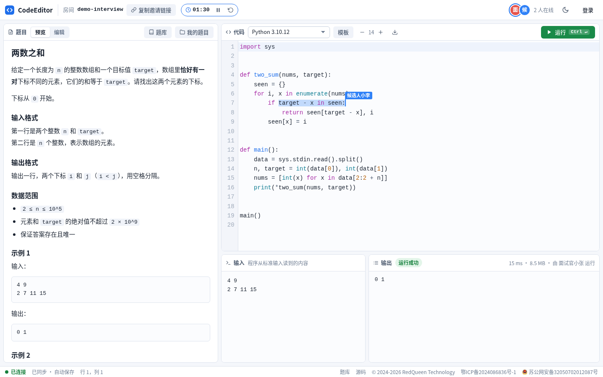
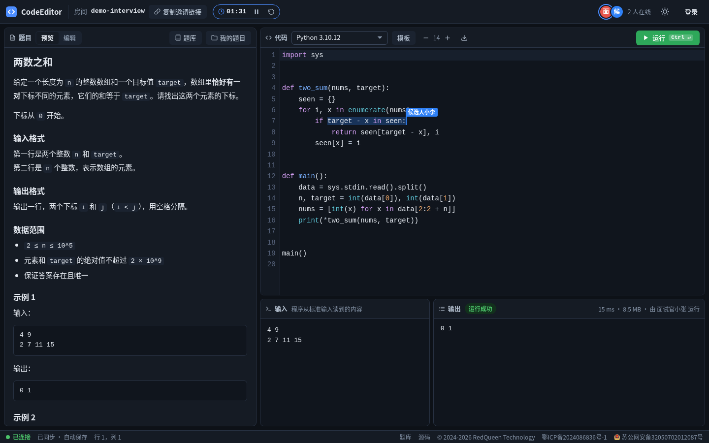
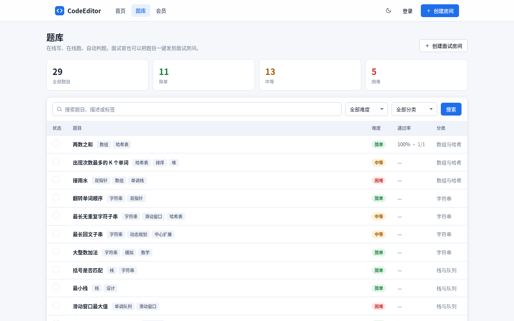
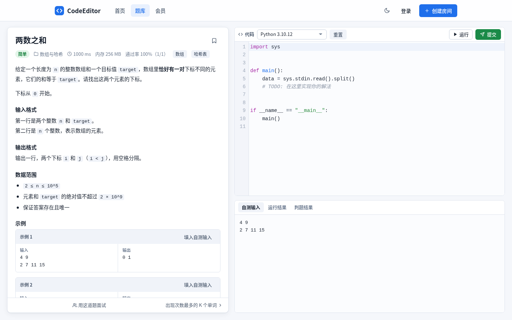

# CodeEditor · 在线代码面试

一个链接，开始一场代码面试：面试官和候选人在同一个编辑器里实时写代码，看得到彼此的光标，点一下就在服务器上运行；题目、输入输出和计时器都在同一个页面里。自带算法题库和自动判题。

线上地址：<https://codeeditor.cn>

*An online coding-interview pad: real-time collaborative editor (operational transformation, remote cursors, own-edits-only undo), sandboxed execution of Python / C / C++ / JavaScript, a shared timer, and a problem bank with an automatic judge. Django 3.2 + Channels, no build step, runs on Python 3.6+.*



| 深色主题 | 题库 | 做题页 |
| --- | --- | --- |
|  |  |  |

## 功能

**面试房间**（`/<房间号>/`，不需要注册）

- 多人实时协同编辑。两个人同时打字不会互相覆盖，光标不会被对方的输入带着跑；能看到每个人的光标、选区和名字。
- 撤销只撤销自己的修改：按 Ctrl+Z 不会把对方刚写的内容撤掉。
- 一键运行：代码在服务器上编译运行，输出、CPU 时间和内存峰值同步给房间里的所有人；支持标准输入。
- 题目面板支持 Markdown；可以从题库选一道题直接发到房间，也可以把自己常用的题目存进个人题库。
- 共享计时器、复制邀请链接（可带名字：`/<房间号>/?name=张三`）、深色 / 浅色主题、可拖动的分栏、手机上的分页布局。
- 断线后继续输入不会丢：恢复连接时自动把双方在此期间的修改合并。房间内容自动保存。

**题库**（`/problems/`）

- 内置 29 道常见的算法面试题，每道题有示例、隐藏测试数据和参考解；也可以在后台自行添加。
- 在线运行（自测输入）和提交判题：逐个用例给出结果、耗时和内存，示例用例会显示输入、期望输出和实际输出。
- 提交记录、收藏、做题状态筛选。

**其他**

- 账号、会员和「长期保存房间」（按次或包年，支付宝收款，可选）。
- 不依赖任何第三方 CDN：编辑器（CodeMirror 5）打包在仓库里，图标是内联 SVG。

## 它是怎么工作的

```
浏览器 ──HTTP──▶ Django 视图 ─────────────┐
   │                                      ├─▶ SQLite（房间内容、题库、提交记录）
   └──WebSocket──▶ Channels consumer ─────┘
                        │
                        ├─ 房间状态（进程内存）：三份共享文档 + 修订历史 + 在线成员 + 计时器
                        └─ 运行 / 判题 ──▶ 线程池 ──▶ sandbox/launcher.py ──▶ 用户程序
```

### 协同编辑

每个房间有三份共享文档：代码、题目、标准输入。同步用的是操作变换（OT）：

- 浏览器把每次修改变成一个「操作」（保留 n 个字符 / 删除 n 个字符 / 插入一段文本），连同它所基于的修订号发给服务器。
- 服务器（[`editor/rooms.py`](editor/rooms.py)、[`editor/ot.py`](editor/ot.py)）把它在此期间已经接受的其他操作「变换」进去，得到一个可以直接作用在最新文本上的操作，应用后广播给其他人，并给发送者一个确认。
- 浏览器端（[`static/js/ot.js`](editor/static/js/ot.js)、[`static/js/sync.js`](editor/static/js/sync.js)）同一时刻只有一个操作在等待确认，其间的本地修改合并进缓冲；收到别人的操作时先对这两者做变换再应用到编辑器。
- 撤销栈里存的是「逆操作」，别人的操作到来时同样对它做变换，所以撤销永远只影响自己的修改。
- 断线重连：服务器保留最近的修订历史，重连时只补发错过的操作；如果服务器已经重启，就以「上次确认的文本」为共同祖先做一次三方合并。
- 长度按 UTF-16 码元计数（和 JavaScript 字符串一致），所以 emoji 等字符在两端的位置不会错位。空闲时客户端会上报文本校验和，对不上就整份重新同步。

算法和线协议沿用了 [ot.js](https://github.com/Operational-Transformation/ot.js)。Python 和 JavaScript 两份实现由测试交叉校验（同一批随机用例，结果必须逐字节一致），另有一个在 Node 里跑的模拟器：多个客户端乱序收发、随机断线、随机撤销，最后所有人的文本必须和服务器一致。

### 运行用户代码

[`editor/sandbox/`](editor/sandbox/) 只用标准库实现，每次运行都会：

- 在一个用完即删的独立目录里执行，环境变量是干净的；
- 限制 CPU 时间、地址空间、单文件大小、打开文件数，禁止 core dump，并设置 `no_new_privs`；
- 有墙上时钟超时，超时后杀掉整个进程组；
- 把输出写到有大小上限的文件里（不用管道，写爆也不会拖住服务进程）；
- 从内核对「那一个子进程」的统计里读出真实的 CPU 时间和内存峰值。

当服务进程以 root 运行时，还会：

- 把每次运行切换到一个专用的非特权 uid（同一时刻一个 uid 只给一次运行用，所以并发的两次运行互相读不到对方的文件），并限制进程数；
- 进入一个空的网络命名空间，程序无法联网；
- 运行结束后杀掉这个 uid 名下残留的全部进程。

**这是加固，不是容器。** 程序仍然可以读取主机上所有用户可读的文件，也没有磁盘配额。部署时请确认数据库和密钥文件对其他用户不可读（例如放在权限为 700 的目录里）；如果要对公网开放并且对隔离要求更高，建议把运行环节换成 nsjail / bubblewrap / Docker。可以随时用下面的命令查看当前主机上实际生效的保护：

```bash
python manage.py sandbox_check
```

它会列出运行身份、可用的语言，并实际跑一遍死循环、内存炸弹、fork 炸弹、输出洪水、联网和读数据库这几个探针。

可用的语言取决于服务器上装了什么：找得到 `python3` / `g++` / `gcc` / `node` 才会出现在语言列表里。

## 本地运行

需要 Python 3.6 或更高版本。

```bash
pip install -r requirements.txt
cp .env.example .env            # 本地开发把 DJANGO_DEBUG 改成 1 即可，不需要 SECRET_KEY
python manage.py migrate
python manage.py seed_problems  # 导入内置题目
python manage.py runserver      # http://127.0.0.1:8000
```

运行测试：

```bash
python manage.py test
```

测试覆盖 OT（含 Python / JavaScript 交叉校验，需要本机有 `node`，没有则跳过）、沙箱、判题、题库数据（每道题的参考解都会真的被判一遍）、页面与接口、会员与支付逻辑、房间 WebSocket，以及「代码必须能被 Python 3.6 解析」。

## 部署

- **只能跑一个 worker 进程。** 房间的实时状态在进程内存里，多个进程之间不共享。

  ```bash
  gunicorn codetool.asgi:application -k uvicorn.workers.UvicornWorker -w 1 --bind unix:gunicorn.sock
  # 或者
  daphne -u gunicorn.sock codetool.asgi:application
  ```

- 配置全部来自环境变量或 `manage.py` 旁边的 `.env`，见 [`.env.example`](.env.example)。生产环境必须设置 `DJANGO_SECRET_KEY`。
- 前面放 nginx：示例见 [`deploy/nginx.conf.example`](deploy/nginx.conf.example)（WebSocket 升级、`X-Real-IP`），systemd 单元示例见 [`deploy/codetool.service.example`](deploy/codetool.service.example)。
- 静态文件由 WhiteNoise 直接从源码目录提供，URL 带内容哈希，**不需要** `collectstatic`（想让 nginx 直接提供静态文件时仍然可以用）。
- 系统自带 SQLite 低于 3.9 的主机（如 CentOS 7）可以用 [`deploy/run_with_sqlite3.sh`](deploy/run_with_sqlite3.sh) 预加载新版库。
- 在容器里运行时请带上 init（`docker run --init`），否则被杀掉的用户进程会变成僵尸进程占住进程数额度。
- 建议用 cron 定期清理长期没人用的房间（会员保存过的房间不会被删）：

  ```bash
  python manage.py cleanup_rooms            # 默认清理闲置超过 ROOM_RETENTION_DAYS（30）天的房间
  python manage.py cleanup_rooms --dry-run  # 只看会删多少
  ```

### 从旧版本升级

1. 备份 `db.sqlite3`。
2. 更新代码。保留服务器上的 `db.sqlite3`、`configs/`（支付宝密钥）和 `editor/static/images/alipay_qir_*.png`（收款码），它们不在仓库里。
3. 创建 `.env`：把原来写在 `settings.py` 里的 `SECRET_KEY` 放进 `DJANGO_SECRET_KEY`（这样已登录的用户不会掉线），并填上备案号等站点信息和 `ALIPAY_*`。
4. `python manage.py migrate`，然后 `python manage.py seed_problems`。
5. `python manage.py collectstatic --noinput`（如果 nginx 直接从 `staticfiles/` 提供 `/static/`，这一步必须做；否则做了也没有坏处）。
6. `python manage.py sandbox_check`，确认运行身份、断网和各语言都符合预期。
7. 重启服务（单 worker）。升级前打开着的旧页面会收到「请刷新」的提示。

## 目录结构

```
codetool/                 Django 工程：settings（读环境变量）、ASGI 入口、根路由
editor/
  models.py               房间、会员与订单、题库、提交记录
  ot.py                   操作变换（服务端）
  rooms.py                房间的实时状态：文档、修订历史、成员、保存与回收
  consumers.py            房间的 WebSocket 协议（文件头部有完整说明）
  sandbox/                运行用户程序：launcher.py（独立进程里设限、降权）、runner.py、languages.py
  execution.py            运行队列（固定大小的线程池）
  judge.py                判题
  payment.py              会员购买（支付宝余额确认）
  ratelimit.py            进程内的滑动窗口限流
  problem_seeds.py        内置题目、参考解和测试数据生成器
  views/                  页面与接口
  management/commands/    seed_problems / cleanup_rooms / sandbox_check
  static/js/              ot.js、sync.js（协同）、room.js、problem.js、md.js（安全的 Markdown 渲染）
  static/vendor/          CodeMirror 5（scripts/vendor_codemirror.sh 可重新生成）
  templates/editor/       页面模板
  tests/                  测试（tests/js 下是在 Node 里跑的交叉校验和模拟器）
deploy/                   nginx / systemd 示例
```

## 已知的限制

- 单进程：房间状态不跨进程，暂不支持水平扩展（需要把房间状态搬到 Redis 之类的共享存储）。
- 沙箱是加固而不是完整隔离，见上文。
- 会员购买用的是「扫固定金额收款码 + 轮询账户余额确认到账」的轻量方案，只适合小站点；流量大了应该换成带支付通知的接口（如支付宝当面付）。
- 目前支持 Python、C、C++、JavaScript；Java / Go 还没有接入。

## 致谢

- [CodeMirror 5](https://codemirror.net/5/)（MIT）
- [ot.js](https://github.com/Operational-Transformation/ot.js)（MIT）：OT 算法与客户端状态机的参考实现
- [Feather](https://feathericons.com/)（MIT）：图标
